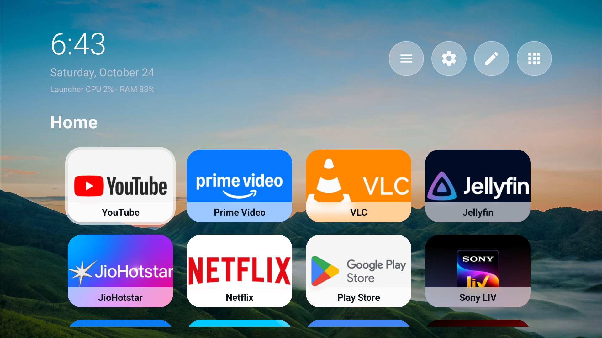

# Custom Home Screen for Acer R4G

Still Home is a small, offline-first Android TV launcher designed for the Acer R4G (Android 14, 32-bit ARMv7, 2 GB RAM). It uses Kotlin, Android Views, and RecyclerView. It contains no ads, analytics, recommendation feed, WebView, network permission, or background service.

## Screenshots

### Home screen



## Features

- Native HOME and Leanback launcher activity with D-pad navigation.
- Local favorites grid populated from installed TV applications.
- Add/remove apps without uninstalling or disabling them.
- Remote-friendly reorder mode: press OK to pick up an app, move with Up/Down, and press OK to place it.
- Persistent order and focus restoration using SharedPreferences.
- Package removal reconciliation and package-change refresh.
- Bounded 6 MB in-memory icon cache with off-main-thread icon loading.
- Clock updated by Android's minute tick only while Home is visible.
- Mountain or solid-dark local appearance; no rendering-time network dependency.
- Reduced-motion aware, transform-only 150 ms focus animations.

## Requirements

- Java 17
- Android SDK 34
- Android build-tools 34 or newer

The checked-in Gradle wrapper uses Gradle 8.10.2. The project targets SDK 34 and requires Android 8.0 (API 26) or newer.

## Build and test

From PowerShell:

```powershell
./gradlew.bat testDebugUnitTest assembleDebug
```

The debug APK is produced at:

```text
app/build/outputs/apk/debug/app-debug.apk
```

## Customize Home

- Choose **Edit apps** on Home to open Settings.
- **Manage Home Apps** pins or unpins installed TV applications.
- **Reorder Apps** lets you pick up and move pinned applications using only the remote.
- Long-press OK on a Home tile to open reorder mode.
- **Appearance** offers six bundled wallpapers in a remote-friendly 3x2 gallery.

Unpinning never uninstalls or disables an application.

## Optional installation and HOME selection

Do not run these commands until deployment is explicitly intended.

Install the debug build:

```powershell
adb install -r app/build/outputs/apk/debug/app-debug.apk
```

After installation, pressing HOME should show Android's launcher chooser. If the firmware does not show it, select Still Home explicitly:

```powershell
adb shell cmd package set-home-activity --user 0 com.shyam.acerlauncher/.MainActivity
```

This does not remove or disable Google TV Home.

### Acer R4G Android 14 HOME override

This firmware gives Google TV Home system priority 2 and SetupWraith's recovery HOME system priority 1, while an ordinary installed launcher is limited to priority 0. The following verified, reversible user-0 override is therefore required after installing Still Home:

```powershell
adb shell pm disable-user --user 0 com.google.android.apps.tv.launcherx
adb shell pm uninstall -k --user 0 com.google.android.tungsten.setupwraith
adb shell cmd package set-home-activity --user 0 com.shyam.acerlauncher/.MainActivity
```

`launcherx` is only disabled for user 0. SetupWraith is removed only from user 0; its read-only system APK remains installed and can be restored. The override was verified across a full TV reboot.

## Roll back to Google TV Home

Restore both higher-priority system HOME handlers, then select Google TV Home:

```powershell
adb shell cmd package install-existing --user 0 com.google.android.tungsten.setupwraith
adb shell pm enable --user 0 com.google.android.apps.tv.launcherx
adb shell cmd package set-home-activity --user 0 com.google.android.apps.tv.launcherx/.home.HomeActivity
```

Confirm the selected HOME activity:

```powershell
adb shell cmd package resolve-activity --brief -a android.intent.action.MAIN -c android.intent.category.HOME
```

Only after restoring Google TV Home, the custom launcher may optionally be removed:

```powershell
adb uninstall com.shyam.acerlauncher
```

## Performance validation

The implementation is structured for low overhead, but performance targets must be measured on the TV after deployment. Suggested read-only checks include `dumpsys meminfo`, `top`, `dumpsys gfxinfo ... framestats`, and Android activity launch metrics. No on-device performance claim is made by the desktop build.

## Known limitations

- Only applications exposing a Leanback launcher activity are listed.
- Reordering currently uses a vertical management list, while Home uses a four-column grid.
- The clock format follows the device locale but currently uses a 12-hour display pattern.
- Cold-start, warm-HOME, memory, CPU, and frame targets require later device measurement.
- Acer R4G Android 14 requires the documented per-user HOME override because its system HOME activities outrank third-party launchers.
